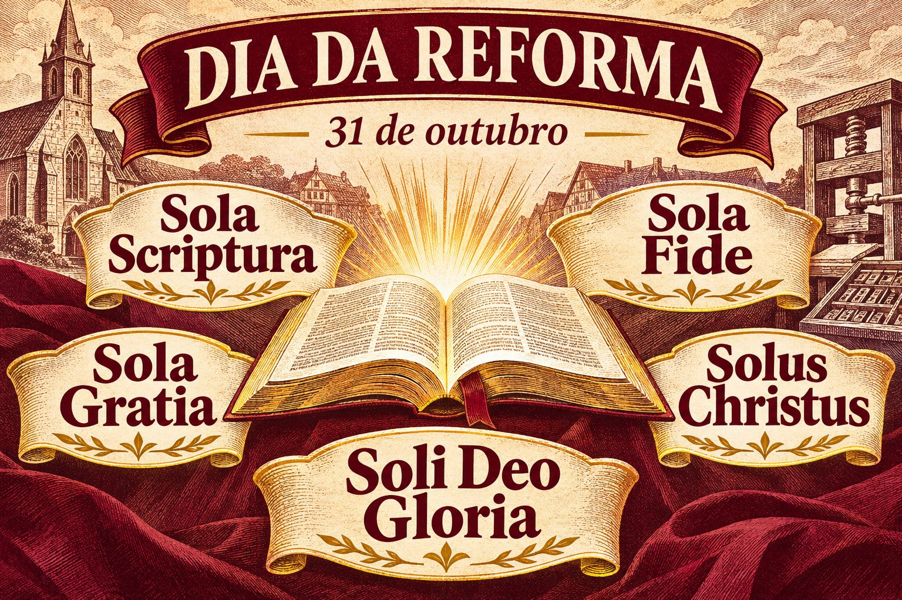

# Dia da Reforma: o que os cinco solas têm a ver com a nossa vida?

Em 31 de outubro, lembramos a Reforma Protestante e seu chamado para voltarmos ao evangelho. Mais do que uma data na história da igreja, é uma oportunidade de refletir sobre aquilo que sustenta a nossa fé.

Os cinco solas resumem convicções centrais dessa herança:

📖 **Sola Scriptura — Somente a Escritura**
A Bíblia é a autoridade suprema para a nossa fé e prática. Nossas escolhas, tradições e experiências precisam ser examinadas à luz da Palavra de Deus.

🤲 **Sola Gratia — Somente a graça**
A salvação é um presente de Deus, não uma conquista dos nossos méritos. Podemos descansar em sua graça e tratar o próximo com a mesma generosidade que recebemos.

❤️ **Sola Fide — Somente a fé**
Somos justificados pela fé, não pelas nossas obras. As boas obras são fruto dessa fé e expressão de gratidão, não o preço da salvação.

✝️ **Solus Christus — Somente Cristo**
Jesus é o único Salvador e mediador entre Deus e a humanidade. Nossa esperança está em quem ele é e no que fez por nós.

✨ **Soli Deo Gloria — Glória somente a Deus**
Toda a glória pertence a Deus. No trabalho, na família e no serviço à comunidade, somos chamados a viver para a sua glória.

Essas verdades nos convidam a confiar mais em Deus, conhecer melhor sua Palavra e viver uma fé que se torna visível no amor ao próximo.

**Qual dos cinco solas mais desafia ou encoraja você neste momento? Como ele pode transformar uma atitude sua nesta semana?**

Compartilhe sua reflexão e marque com @ um membro que você gostaria de ouvir nesta conversa. 💬

